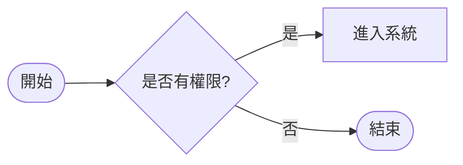
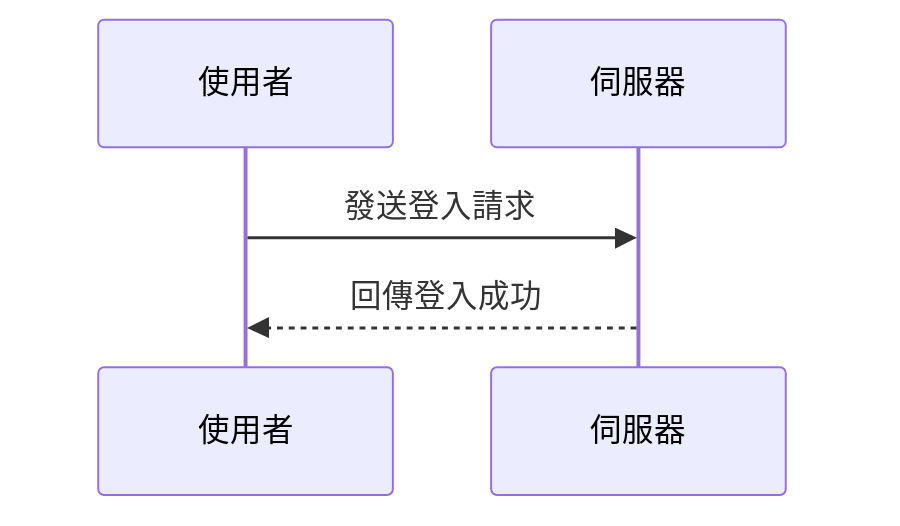
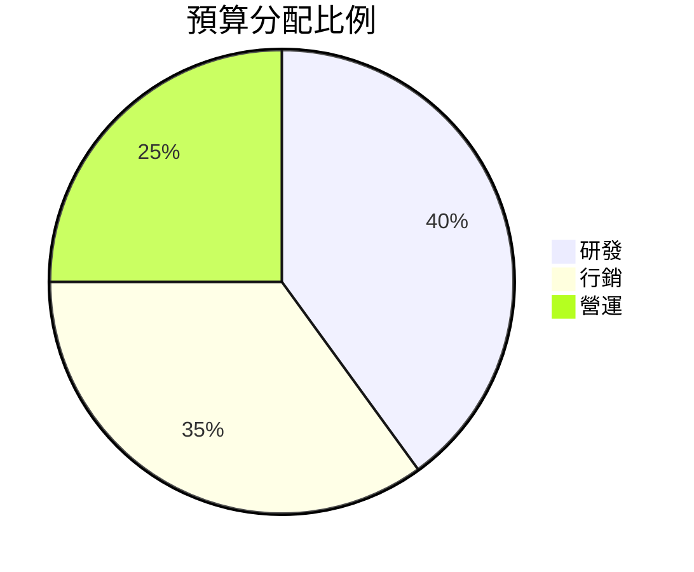
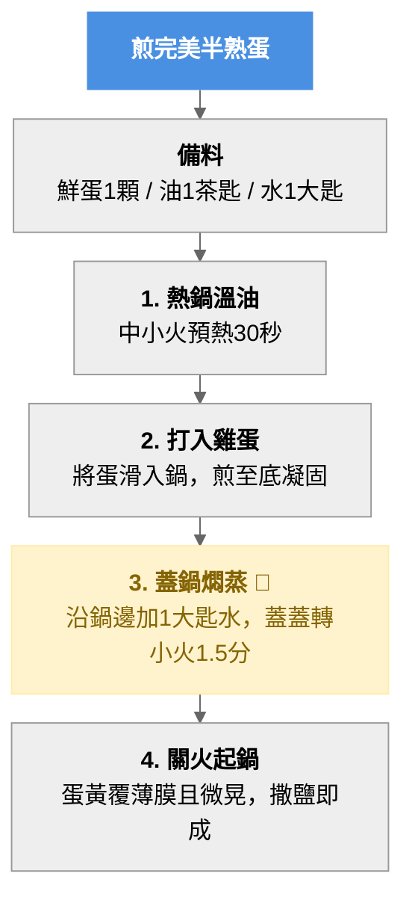

#obsidian #安裝 #密碼 #mermaid #流程圖
P-L.q65$kf4,vBz %%密碼%%

三個頓號（esc下面那個按鍵）+mermaid
貼上mermaid程式碼  
三個頓號結束  
按右上角閲讀模式

flowchart LR
    A([開始]) --> B{是否有權限?}
    B -- 是 --> C[進入系統]
    B -- 否 --> D([結束])

sequenceDiagram
    participant 使用者
    participant 伺服器
    使用者->>伺服器: 發送登入請求
    伺服器-->>使用者: 回傳登入成功

pie title 預算分配比例
    "研發" : 40
    "行銷" : 35
    "營運" : 25

win+上下左右 %%視窗排列%%

![[Pasted image 20261001105827.png]]
 搜尋learn how to learn
 